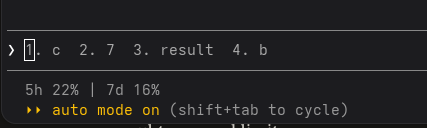

# Reviews: c1-skills

Your quick rounds while you build `c1-skills`, and then its major review, once you have snapshotted it and made its full run.
In this step no round adds a subagent, because subagents arrive in `c2-review` and `c3-split`: a round changes or adds a skill, or makes another change the skills need, such as an allow rule (Kind `other`).
Your first round can start from the tutor as it ships, so the baseline is the output without your first change.
The major review covers all four jobs, and its previous step is `c0-baseline`, so compare with your baseline runs.
What it finds becomes the checklists of your reviewer subagents in `c2-review`, so be specific.
`reviews/README.md` says how to write each part.
You write your thoughts, ratings and feedback; Claude Code writes only the What changed part of each round.
Keep every heading as it is, because `p3 check` reads them, and add a round by copying the last one with its marker lines.

## Quick rounds

### Round 1

**Run:** bench/runs/_live/20261104-191544-agent-architecture-m30-r1

**My thoughts:**

It is ok, I like that it related topics to traditional programming ideas. I could learn from it, but it seems pretty dry and technical, which makes reading all the way through difficult.

**What changed:**

- Kind: modified skill
- Files: tutor/.claude/skills/teach/SKILL.md
- Why: You found the lesson dry and technical to read through, so teach now has a "voice of a lesson" section: talk to one person, open each section with a problem, anchor ideas in CS analogies (which you liked), plain words before terms, and short stretches with a practice check.

### Round 2

**Run:** bench/runs/_live/20261104-195244-agent-architecture-m30-r1

**My thoughts:**

 It is noticably easier to read. It reads less technical and more conversation, which is better when trying to read an article and learn. It might have gone a little heavy on the CS comparisons, but i understood it well and the comparisons made sense to me.

**What changed:**

- Kind: modified skill
- Files: tutor/.claude/skills/teach/SKILL.md
- Why: You found the lesson easier to read but a little heavy on CS comparisons, so the voice section now rations analogies to at most one per idea, used only where they clarify.

### Round 3

**Run:** bench/runs/_live/20261104-221953-agent-architecture-m30-r1

**My thoughts:** 
The tutor for p01 did a good job I think, it did not point to one answer but the way it aasked questions made me know the right answer pretty quickly. The response was a little long, but the information was good.
For po2,  I feel like saying the right answer should align with other questions is too much help, especially if the student knew the answers to those other questions. It did not directly lead the student, but it still could end up leading them to the correct answer relatively easily. The response was a little long but not too bad.

**What changed:**

- Kind: modified skill
- Files: tutor/.claude/skills/teach/references/TUTORING.md
- Why: In tutor-p02 the reply said q5 and q6 "touch the same mechanism" so your answers there should agree with q2, which you found too much help; the tutoring guide now forbids pointing to other quiz items and sends the learner to their own notes and reasoning.

### Round 4

**Run:** bench/runs/_live/20261104-224647-agent-architecture-m30-r1

**My thoughts:**
The tutor's response for p01 seems very helpful. It gave ways to test the answers and used the questions wording to point out ways to eliminate other answers without giving any answers or hints outside of what the question says, which I do not think is wrong.
The tutor's response for p02 is fine, it doesnt give hints but doesn't seem as helpful as p01. It does do what it is supposed to do, I just do not think it would help me much.

**What changed:**

- Kind: modified skill
- Files: tutor/.claude/skills/teach/references/TUTORING.md
- Why: You found the tutor-p02 reply correct but not very helpful, so the guide now asks a declined quiz-answer reply to be specific to the item (its topic, the lesson section that covers it, the stem's wording, one question about the learner's reasoning) instead of a generic study routine.

### Round 5

**Run:** bench/runs/_live/20261104-225839-agent-architecture-m30-r1

**My thoughts:**
I think this round went well with the answers, I think it would be better if tutor was its own skill, add the skill and chege the CLAUDE.md to use this skill for tutor prompts

**What changed:**

- Kind: new skill
- Files: tutor/.claude/skills/tutor/SKILL.md, tutor/CLAUDE.md
- Why: You asked for tutor to be its own skill with CLAUDE.md routing tutor prompts to it, so /tutor now answers chat messages and follows the same tutoring guide, and CLAUDE.md sends questions to /tutor and lessons, quizzes and grading to /teach.

### Round 6

**Run:** bench/runs/_live/20261104-230654-agent-architecture-m30-r1

**My thoughts:**
The tutor seems better, no changes needed. Make quiz a skill to see if it would output better quizzes

**What changed:**

- Kind: new skill
- Files: tutor/.claude/skills/quiz/SKILL.md, tutor/CLAUDE.md
- Why: You asked for quiz to be its own skill to see if it writes better quizzes, so /quiz now writes the quiz and its key (with a self-check for items that can be read two ways or repeat words from the stem), and CLAUDE.md routes quiz requests to it.

### Round  7

**Run:** bench/runs/_live/20261104-231813-agent-architecture-m30-r1

**My thoughts:**
The quiz seems good, I think the difficulty is very reasonable and if the student understands the material they should get a good grade. Make a grading skill that also offers to make another similaar quiz for students to practice with and get the topics they misundertand down well

**What changed:**

- Kind: new skill
- Files: tutor/.claude/skills/grade/SKILL.md, tutor/CLAUDE.md, tutor/.claude/skills/quiz/SKILL.md, tutor/.claude/skills/tutor/SKILL.md
- Why: You asked for a grading skill that offers a practice quiz on the topics the learner missed, so /grade now grades every answer and ends by offering that quiz when any answer was partial or wrong; CLAUDE.md and the two skills that named /teach for grading now point to /grade.

## Major review

**Run:** bench/runs/c1-skills/20261108-185311-agent-architecture-m30-r1

**Live tries:**

I had the tutor make a lesson on when the agent loop exits. The lesson was a good length and was easy to read, the quizzes in the lesson seemed to help me remember what the lesson was about. 
When I asked for the lesson, the tutor told me that there was no mission.md written yet and to give me the information needed to write it. It took 3 prompts to get it to tell me what information mission.md wanted. I feel like this should have been an easy task and the tutor made it more difficult then it should have been.
I took the quiz after reading the lesson, and the model tried to predict what I would type in the response, which gave me the answers to the quiz questions (Figure 1). I am not sure how to fix this, my code in terminal started doing this recently and makes quizzes with claude kind of useless now if it is going to tell you the answers immediately.

**Figure 1**

### Lesson

#### Technical correctness and facts

Rating: 5
Live Try:
I did not see anything incorrect in the lesson. The way it explained why agents use no tool call as a reason to exit made sense, especially when comparing it to a while loop. I understood what the lesson wanted me to learn easily.

Run output:
The lesson the run made is much more in depth than the live try lesson, which is both goo and bad. There is more information in it and it seems to go into a little more depth than the live try lesson, but they are on different topics so it is difficult to compare. I did not see any incorrect information in the lesson, and it used a while loop again to explain how the context is appending to the new prompt.

#### Pedagogy

Rating: 4

Live Try:
I think the lesson was good, but not the best it could be. It was easy to read and I liked the questions in the lesson, they were easy but also tested if you understood what you read before the question. I am more likely to do questions like that over hard questions that take time to answer, I would just skip those or look at the correct answer. The examples it gave were good and what I asked for (using CS concepts to explain LLM topics), like comparing when an agent stops by using a while loop with the exit condition being the response not having a tool call.

Run output:
This lesson had a similar format to the live try lesson, and the questions in the lesson were also easy but made sure that you read the lesson to be able to answer the questions easily. It used a while loop comparison to how the prompt is constructed before it is sent to the model, which I found helpful. It made it easy to understand what is passed to the model for every prompt and why more tokens are used on every request.

#### Alignment with the learning goal

Rating: 5

I asked the tutor to make a lesson about when the agent loop stops, and that is what it made. The lesson did not go off-topic and only wrote about what makes the loop stop and why. It seemed like a reasonable level of difficulty, maybe a little easy for me but it did teach what I asked it to well, and the tutor does not know what section I am in, so it only knows 498/598. If i told it I was in 598, it might have made a slightly harder lesson.

#### Overall quality

Rating: 4

The tutor did a good job and did what it was supposed to do, this just is not really how I learn. To study, I basically only do a lot of practice problems. This is the best way I have found to gain confidence on exams and understand material better, so creating a lesson like this would not help me much. However, the lesson it created did follow my instructions and what I wanted from a lesson, and I could learn from it easily. 

### Quiz

#### Difficulty

Rating: 4

I do not think the quiz was too dificult, but question 4 I do not remember learning in the lesson at all. I would not have gotten this correct on a quiz, the lesson mentioned budget caps and does mention teh answer to q4, but only in a dropdown under a practice question which is easily missed. It did not go into any detail or explain what happens when one is reached, which is what question 4 was asking.

#### Coverage of the lesson's core

Rating: TODO

TODO

#### Wording and possible misreadings

Rating: TODO

TODO

#### Writing quality

Rating: TODO

TODO

#### Alignment with the learning goal

Rating: TODO

TODO

### Feedback

#### Useful

Rating: TODO

TODO

#### Explains enough

Rating: TODO

TODO

#### Personalized to how I like things explained

Rating: TODO

TODO

### Tutor

#### Guardrails

Rating: TODO

TODO

#### Personalization

Rating: TODO

TODO

### Compared with the previous step

TODO

### What the next step should fix

TODO
